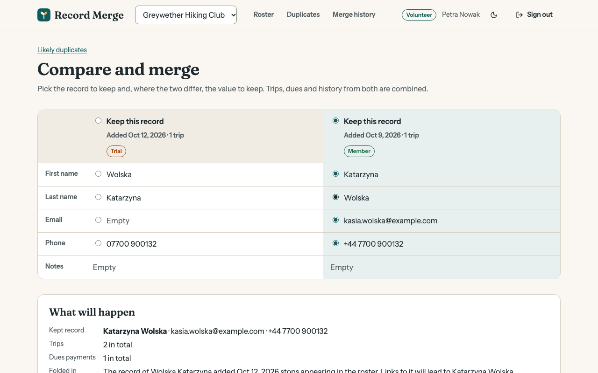

# Record Merge

A hiking club's member roster that finds duplicate people and merges them safely, with undo.

[](https://github.com/Nawfaldev19/safe-record-merge/actions/workflows/ci.yml)
[](LICENSE)



> **About this screenshot.** It shows the seeded demo data. To take it again after a
> design change: run `npm run demo`, open <http://localhost:4100>, choose "Continue
> as volunteer", open **Duplicates**, press **Compare** on the Katarzyna Wolska pair,
> set the browser window to 1280 × 800, and save the visible page as
> `docs/screenshots/compare.png`.

Record Merge is a portfolio demo, not a product. Everything in it is fictional: the
clubs, the people and their details.

## What this demonstrates

1. **A destructive operation made safe.** Merging two records happens in one
   transaction and writes a journal entry listing exactly what it changed. Undo
   replays the journal backwards, and refuses when that would lose later edits. See
   [`src/server/services/merge-service.ts`](src/server/services/merge-service.ts),
   tested in [`tests/integration/merge.test.ts`](tests/integration/merge.test.ts).
2. **Matching with stated trade-offs.** Duplicates are found by email, phone and
   name, tolerant of accents, typing mistakes and swapped names. Blocking keeps the
   work far below comparing everyone with everyone, and each suggestion explains
   itself. See [`src/server/domain/matching.ts`](src/server/domain/matching.ts) and
   [`tests/unit/matching.test.ts`](tests/unit/matching.test.ts).
3. **Pure domain logic, separate from storage and transport.** Matching, stage
   rules, CSV escaping and the merge screen's decisions are plain functions with
   direct tests. See [`src/shared/stage.ts`](src/shared/stage.ts),
   [`src/server/domain/`](src/server/domain/) and
   [`src/web/features/merge/merge-model.ts`](src/web/features/merge/merge-model.ts).
4. **Tenant isolation enforced by the database.** Postgres row-level security fences
   every query into one club. See
   [`src/server/db/migrations.ts`](src/server/db/migrations.ts) and
   [`tests/integration/tenant-isolation.test.ts`](tests/integration/tenant-isolation.test.ts).
5. **Data handled with care at the edges.** A streamed CSV export that cannot be
   used for formula injection, keyset paging on two sort orders, optimistic locking
   on edits, and search that treats wildcards as text. See
   [`src/server/domain/csv.ts`](src/server/domain/csv.ts),
   [`src/server/services/export-service.ts`](src/server/services/export-service.ts)
   and [`src/server/services/member-service.ts`](src/server/services/member-service.ts).
6. **A clear interface for a risky decision.** A side-by-side comparison with a
   choice per field, sensible defaults, and a plain-language summary of what will
   happen before anything does. See
   [`src/web/features/merge/MergePage.tsx`](src/web/features/merge/MergePage.tsx).

## Quick start

You need [Node.js](https://nodejs.org) 20.19 or newer. Nothing else: the database is
embedded.

```bash
npm install
npm run demo
```

Then open <http://localhost:4100>. The start page explains the demo and signs you in
with one click.

| Demo account | Email                | Password         | Can                                                                |
| ------------ | -------------------- | ---------------- | ------------------------------------------------------------------ |
| Organizer    | `hollis@example.com` | `trailhead-demo` | Everything, including undoing merges; is a reader in a second club |
| Volunteer    | `petra@example.com`  | `trailhead-demo` | Add, edit, merge and export                                        |
| Reader       | `jun@example.com`    | `trailhead-demo` | Look, and nothing else                                             |

Things to try: open **Duplicates** as the volunteer. The seed data holds one
duplicate of each kind (same email in different capitals, swapped first and last
name, a typing mistake, a double sign-up) and one pair that only looks alike. Compare
a pair, merge it, then sign in as the organizer and undo it under **Merge history**.

The demo data lives in `.data/`. Delete that folder to start again from fresh seed
data.

### Other commands

| Command                     | What it does                                                                              |
| --------------------------- | ----------------------------------------------------------------------------------------- |
| `npm run dev`               | API with reload on port 4100 and the web app with hot reload on port 5175                 |
| `npm run check`             | Lint, type check, unit, integration and component tests with coverage, then build         |
| `npm run test:e2e`          | Browser tests against the production build (first run: `npx playwright install chromium`) |
| `npm run codegen`           | Rewrite `schema.graphql` and the client's schema types after an API change                |
| `docker compose up --build` | Run the production build in a container on port 4100                                      |

If Playwright has no browser build for your operating system, run the browser tests
with an installed Chrome instead: `PW_CHANNEL=chrome npm run test:e2e`.

## Tech stack

| Choice                                    | Why                                                                                        |
| ----------------------------------------- | ------------------------------------------------------------------------------------------ |
| TypeScript, strict mode                   | One language and one set of types from the database edge to the browser                    |
| PGlite (Postgres compiled to WebAssembly) | Real transactions, row locks and row-level security with no database to install            |
| GraphQL Yoga with Pothos                  | A schema written in TypeScript, so resolvers are checked against the service types         |
| React 19 with React Router                | Plain client-rendered pages are enough here                                                |
| urql with gql.tada                        | A small GraphQL client, with result types inferred from the schema                         |
| Plain CSS with custom properties          | The shared design tokens stay visible, and the licence list stays short                    |
| Zod                                       | Validates every input at the API edge and the environment at start-up                      |
| Vitest, Testing Library, Playwright       | One fast runner for unit, integration and component tests; a real browser for the journeys |

## Documentation

- [Plan](docs/PLAN.md): goals, scope and the order the work was done in
- [Architecture](docs/ARCHITECTURE.md): the parts, the data model, matching, merging and undo
- [Decisions](docs/DECISIONS.md): nine architecture decision records with the alternatives that were rejected
- [Testing](docs/TESTING.md): what each test layer covers, coverage numbers and known gaps
- [Security](docs/SECURITY.md): threat model, controls, and what is deliberately not covered
- [References](docs/REFERENCES.md): specifications, documentation and books behind the patterns used

## Scope and limitations

- **Matching is rule-based, not learned.** The weights and thresholds were chosen by
  reasoning and by the seed data, not tuned on real rosters. A pair that differs in
  email, phone and the first letters of both names at once will not be suggested.
- **Duplicates are found on request, in memory.** Each visit to the page reads the
  matching columns of every active record. That is fine for a few thousand people
  (a test covers 3,000) and would need precomputed candidates beyond that.
- **Undo is all or nothing, and newest first.** A merge can be undone only while the
  kept record is unchanged since. After an edit, or after a later merge was undone,
  it has to be fixed by hand. This is deliberate (see ADR 3).
- **Trips and dues are read-only.** They come from seed data, so that merging has
  something real to combine. There are no screens for entering them.
- **No member management for the application's own users.** The three demo accounts
  come from seed data.
- **One process, one connection.** The embedded database handles one transaction at
  a time. The locking in the merge is written for a database with many connections,
  but has only been run on one.
- **The container setup is not covered by CI.** `Dockerfile` and `docker-compose.yml`
  are provided for convenience; `npm run demo` is the tested path.

## Author

Nawfal Imran · [GitHub](https://github.com/Nawfaldev19) · [LinkedIn](https://www.linkedin.com/in/nawfal-imran-886b13218)

## License

[MIT](LICENSE). Third-party packages and fonts are listed in
[THIRD_PARTY_NOTICES.md](THIRD_PARTY_NOTICES.md).
