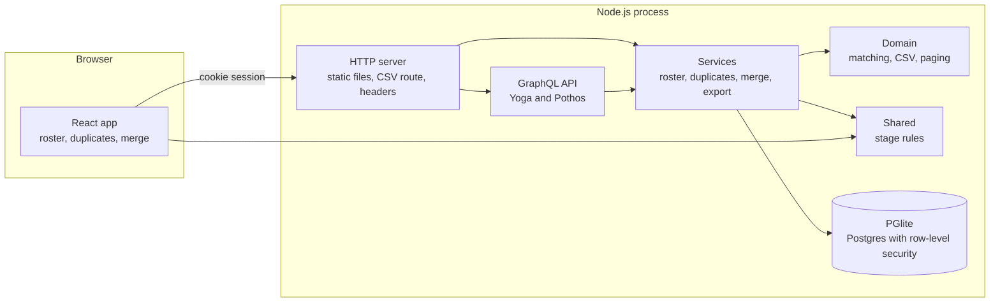
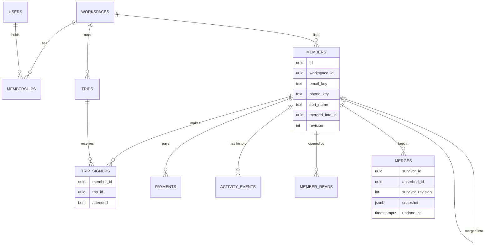
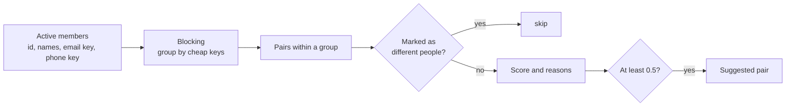
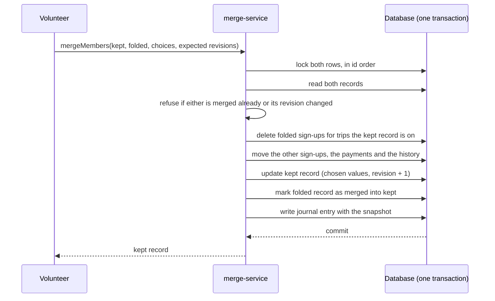
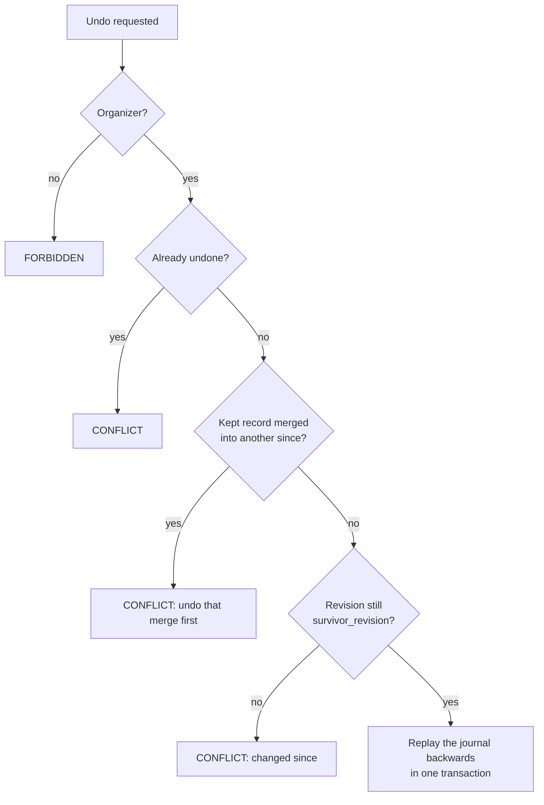

# Architecture

## The parts

Record Merge is one Node.js process. It serves the built web app, answers a GraphQL API,
streams the CSV export, and holds an embedded Postgres database.



## Layers and their rules

| Layer    | Folder                | May depend on          | Knows about                                                                         |
| -------- | --------------------- | ---------------------- | ----------------------------------------------------------------------------------- |
| Shared   | `src/shared`          | nothing                | Stage rules. Runs in the browser and on the server                                  |
| Domain   | `src/server/domain`   | nothing outside itself | Matching, CSV escaping, cursors, hashing, rate limits, errors. No database, no HTTP |
| Database | `src/server/db`       | domain                 | The schema, policies, and the three ways to open a transaction                      |
| Services | `src/server/services` | all of the above       | Use cases. Each function takes its dependencies and a `Scope`                       |
| API      | `src/server/graphql`  | services               | Types and arguments. No business rules                                              |
| HTTP     | `src/server/http`     | services, API          | Routing, headers, the streamed export                                               |
| Web      | `src/web`             | shared                 | Pages and components. Talks to the server only through GraphQL                      |

The domain layer holds the parts worth reasoning about on their own. `matching.ts`
has no idea what a database is: it takes a list of plain objects and returns pairs.
That is why its edge cases, and its behaviour on 3,000 records, are unit tests that
run in milliseconds.

## Data model



"Members" are people on a club's list. The people who sign in to Record Merge are
"users", and a user's place in a club is a "membership".

Points worth noticing:

- **`email_key`, `phone_key` and `sort_name` are normalized copies** written by the
  application whenever the fields they come from change. Matching and sorting read
  them, so normalization happens once per write and not once per comparison.
- **`merged_into_id` turns a merged record into a signpost.** The row is not
  deleted. It no longer appears in lists, and looking it up leads to the record it
  points at.
- **`revision` goes up by one on every change to a member.** Edits use it for
  optimistic locking, and undo uses it to know whether the present still matches
  what the journal describes.
- **A trip sign-up is unique per person and trip.** That constraint is what makes
  merging interesting: two records of one person may both be on the same trip.
- **Stage is not stored.** It is derived from dues and trips (see below).

## Stages

A person's stage is computed from facts by one pure function
(`deriveStage` in `src/shared/stage.ts`):

1. a stage fixed by hand wins;
2. otherwise "member" while the latest dues payment still covers today, "lapsed" if
   it no longer does;
3. otherwise "trial" after a first trip, and "enquiry" before.

The roster filters by stage, so the same rules exist once more as a SQL `CASE` in
`member-service.ts`. An integration test loads people in every stage and asserts
that SQL and the function agree for each of them.

## Finding duplicates



**Blocking.** Comparing all pairs of _n_ records costs _n(n−1)/2_ comparisons. So
each record is put into up to three groups: one for its email key, one for its phone
key, and one for the first three letters of each word of its name (sorted, so that
"Ito Jun" and "Jun Ito" land together). Only records that share a group are
compared. On a synthetic roster of 3,000 people the unit test asserts fewer than a
fiftieth of the all-pairs comparisons.

**Scoring.** Evidence adds up and is capped at 1: the same email adds 0.6, the same
phone 0.5, the same name (in either order) 0.45, a very similar name 0.3. Each piece
of evidence also adds a sentence, so every suggestion says why it was made. The
threshold is 0.5: a shared email or phone is enough on its own; a name is not.

**Name similarity** uses edit distance in which swapping two neighbouring letters
counts as one step, after removing accents, case and punctuation.

**The trade-off.** A pair that shares no email, no phone, and whose names differ
within the first three letters of a word is never compared, so it cannot be found.
That is the price of blocking, and it is stated in the README.

## Merging



Everything happens inside one transaction opened for the caller's workspace. If any
step fails, including the last one, nothing is changed. A test forces the journal
write to fail and checks that both records, their sign-ups and their payments are
exactly as before.

Both rows are locked before anything is read, in id order. Two people merging the
same pair at once (in either direction) therefore take turns, and the second finds
the pair already merged.

The caller sends the revision of each record as it was shown on screen. If either
has changed, the merge is refused: the person was looking at stale data.

## The journal and undo

The journal entry (`merges.snapshot`) records what the merge did in terms that can
be reversed without interpretation:

| Recorded                                                    | Used on undo to             |
| ----------------------------------------------------------- | --------------------------- |
| The kept record's fields before the merge                   | Restore them                |
| Ids of sign-ups that were moved                             | Move them back              |
| Sign-ups that were dropped (id, trip, attended, created at) | Re-create them as they were |
| Ids of kept sign-ups whose "attended" was raised            | Lower them again            |
| Ids of payments and history entries that were moved         | Move them back              |

It also stores `survivor_revision`: the kept record's revision right after the merge.



The revision check is the heart of it. If the kept record's revision still equals
the one written at merge time, nothing has changed it since, so the journal
describes the present exactly and can be replayed. If someone edited the record, or
merged a third record into it, the numbers differ and undo is refused with a
sentence that says why. Refusing is the safe answer: replaying an out-of-date journal
would overwrite those later changes.

A consequence is that stacked merges must be undone newest first, and that undoing
the second of two merges (itself a change) closes the door on undoing the first. The
tests pin this behaviour down, and ADR 3 explains why it was chosen over something
cleverer.

## Signposts and chains

`getMember` follows `merged_into_id` until it reaches a record that is not merged,
with a limit on the number of hops. If A was merged into B and B into C, a link to A
shows C, and says that an older record was merged into it. The self-reference is a
composite foreign key, so a signpost cannot point into another workspace, and a check
constraint stops a record pointing at itself.

## Tenancy

The model is the same as in a typical row-level-security design: the server never
queries tenant data as the database owner. `Database` offers three doors
(`src/server/db/database.ts`):

- `tenant(workspaceId, work)` opens a transaction, switches to the `app_tenant` role
  and sets `app.workspace_id`. Policies limit every statement to that workspace, and
  match nothing if the setting is missing.
- `directory(work)` switches to `app_directory`, which can read users, memberships
  and sessions and has no access to the roster.
- `admin` is the owner connection, used by migrations, the seed script and tests.

`requireScope` adds an independent check before any service runs: a user who is not
in a club gets `NOT_FOUND`, the same answer as for a club that does not exist.

## Performance reasoning

- **Duplicate search** loads five columns per active record, not whole rows, and
  fetches full records only for the pairs it shows (in one query).
- **Roster paging** is by key on either sort order: `(sort_name, id)` ascending or
  `(created_at, id)` descending, each with a partial index that leaves out merged
  records. Page 100 costs the same as page 1.
- **Stage counts and stage filters** are computed in SQL in the same query as the
  rows, using correlated subqueries on indexed columns.
- **The export** fetches 200 rows at a time by key and writes each row as it goes,
  waiting when the client reads slowly. Memory use does not grow with the roster. A
  test exports 450 rows and checks the size of the largest single write.
- **Known ceiling.** The duplicate search is linear in the roster and runs per
  request. Past tens of thousands of records the candidates should be maintained
  incrementally (on each write, compare the changed record against its blocks) and
  stored. The blocking functions are already written per record, which is the form
  that needs.

## Error handling

Services throw `AppError` with a stable code and, for validation, issues that name
the input they concern. The API passes these to the client in `extensions`. Anything
else is a bug: it is logged in full as structured JSON, and the client is told only
that something went wrong. Conflicts (`CONFLICT`) always carry a sentence a person
can act on, because a refused merge or undo is something the user has to understand.

## Web app structure

```
src/web
  styles/       tokens.css (design tokens), base.css, components.css
  graphql/      the client and every typed operation
  lib/          error reading, formatting, hooks, theme
  components/   presentation only: buttons, fields, dialog, toasts, badges
  features/     auth, shell, landing, roster, member, duplicates, merge
```

The comparison screen keeps its decisions in `features/merge/merge-model.ts`: which
record to keep by default, where each field starts, what the result will be, and how
"left and right" translate into the API's "kept and folded in". The page itself only
renders those answers.
